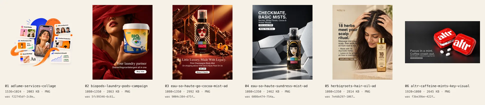

# Asset inventory

Audit of the visual assets supplied for the Adsflux website. Each image was inspected visually; the original filenames were UUIDs and said nothing about the content. Every original has been **renamed to a readable name**, with its content byte-identical (SHA-1 verified before and after the rename).

## Summary

| | |
|---|---|
| Assets discovered | **6** PNG supplied + **6** Scalvo UI captures (see Scalvo platform below) + **4** videos (0 SVG, 0 GIF, 0 team/BTS photos, 0 client logos) |
| Duplicates | None. All six SHA-1 hashes are different |
| Assets selected and placed | **10** (1 hero, 5 image + 4 video showcase). Each asset is used once |
| Assets intentionally unused | 0 |
| Original storage | 16.2 MB (6 PNG, 2.0–3.1 MB each) |
| Optimized storage | 1.84 MB for all 34 variants (AVIF + WebP, 2–3 widths each) |
| Hero, delivered | up to 66 KB AVIF depending on screen (transparent cut-out; backdrop is inline SVG) |

## File names: supplied → renamed

All files live in `assets/originals/`, which is not deployed. `assets/manifest.json` records each mapping with its SHA-1.

| Renamed to | Supplied as | Size |
|---|---|---|
| `adsflux-services-collage.png` | `f22745df-2c8e-4667-aabd-71fa0f7f4b7d.png` | 1536×1024, 2.0 MB, **transparent** |
| `biopods-laundry-pods-campaign.png` | `5fc99346-6c61-4e05-aa42-4ba1c0c168a9.png` | 1080×1350, 2.9 MB |
| `eau-so-haute-go-cocoa-mist-ad.png` | `9004c384-d75f-4a2b-9dd6-972bd9d922fa.png` | 1080×1350, 3.1 MB |
| `eau-so-haute-sundress-mist-ad.png` | `6086e474-754a-4654-a6a7-4c8bb3e3f5ea.png` | 1080×1350, 2.5 MB |
| `herbiqroots-hair-oil-ad.png` | `7e4db297-1067-4591-93aa-042813295693.png` | 1080×1350, 2.9 MB |
| `altr-caffeine-mints-key-visual.png` | `f3be39be-422f-4175-9d59-7ab2bb646f76.png` | 1920×1080, 2.7 MB |

Optimized variants use the same readable names: `public/assets/<group>/<name>-<width>.{avif,webp}`.

## Where things live

| Path | What |
|---|---|
| `assets/originals/` | The originals, renamed, content unchanged. Never edit or delete them |
| `assets/manifest.json` | New name ↔ supplied name, SHA-1, dimensions, bytes; plus `derived` entries |
| `assets/derived/` | Sources derived from originals by a script (not deployed). `adsflux-services-cutout.png` comes from `scripts/derive-hero-cutout.py` (Python: numpy, opencv-python-headless, pillow) |
| `scripts/optimize-assets.mjs` | The pipeline (`npm run assets`): crop, resize (never upscales), AVIF q52 + WebP q78, dominant colour, real-transparency detection (alpha kept only when used) |
| `public/assets/hero/`, `public/assets/campaigns/` | Deployed variants |
| `src/assets/generated/imageManifest.ts` | Generated: dimensions, variants, bytes, colour, `hasAlpha` |
| `src/assets/assetRegistry.ts` | What the site uses: generated data plus alt text, subject, placement, attribution |

## Placement

### Hero

| Asset | Actual content | Display | Variants (AVIF / WebP) | Notes |
|---|---|---|---|---|
| `adsflux-services-cutout` (derived from `adsflux-services-collage.png`) | A phone playing a skincare reel, surrounded by six service cards (Social Media, Performance Ads, UGC & Influencers, Creative Production, Brand Strategy, Analytics & Growth). The original's cobalt blob, orange ring-text disc, brush stroke, orbit line and dots are **removed** (the phone corner the stroke covered is rebuilt) and **redrawn as animated SVG** in `src/pages/home/sections/hero-collage/`. **Transparent background.** | **Home hero, main visual (LCP)**, uncropped 3:2 (1536×1024) so it shares coordinates with the SVG layers (backdrop behind; brush strokes between the phone and the cards). The image is rendered once per piece (phone + six cards), each clipped by the outlines in `src/assets/generated/heroCutoutPieces.ts`, so every piece settles in, floats and follows the pointer on its own — one download, the phone carries the alt text. Frameless, bleeding to the screen edge. `priority`, preloaded, `fetchpriority="high"`, no entrance animation on the image itself | 640w · 960w · 1280w · 1536w (largest AVIF 66 KB) | Placed at your request. **It contains illustrative metrics** ("ROAS 4.8×", "+237% Engagement", "+142% Conversions"). In a hero they read as Adsflux's results. Use verified numbers or remove them from the artwork before launch. Registered with `attribution: 'concept'` |

### Creative Showcase (home, section 02, ink band)

| Slot | Asset | Actual content | Display | Largest AVIF |
|---|---|---|---|---|
| 1 | `eau-so-haute-go-cocoa-mist-ad` | Fragrance mist among chocolate, coffee beans and dripping caramel on red; serif headline, offer, CTA | Lead piece, 4:5, full ad. *Product ads* | 76.9 KB |
| 2 | `altr-caffeine-mints-key-visual` | Two red caffeine-mint tins with mints on dark; headline + CTA | Wide piece, 16:9, full ad. *Brand campaigns* | 34.2 KB |
| 3 | `herbiqroots-hair-oil-ad` | Woman massaging oil into her scalp beside the hair-oil bottle; educational copy + CTA | 4:5, slight rotation, full ad. *Social creatives* | 59.5 KB |
| 4 | `eau-so-haute-sundress-mist-ad` | Fragrance mist on concrete with sculptural grey hexagons; price-led headline | 4:5, full ad. *Performance ads* | 55.8 KB |
| 5 | `biopods-laundry-pods-campaign` | Model in deep red drapery holding a tub of laundry pods | 4:5 photograph, **cropped above the baked-in copy** (which contains typos). *Brand campaigns*. **Moved here from the hero** when the services collage took over | 33.0 KB |

Collage `sizes` are set per slot, so browsers download the right width.

### Scalvo platform (home, section 02, peach band)

Captured on 2026-11-07 from the hero mock-up on https://www.scalvo.io/ (headless Chromium at 2x, transparent background, Scalvo's blurred shadow removed). Each layer has a light and a dark version. The dark set is rendered with Scalvo's own `.dark` theme tokens, but scalvo.io shows no dark mode, so treat it as a **concept** until Scalvo confirms it ships. All names and numbers are Scalvo's **illustrative example data** (captioned on the site). The mock-up's reel card was left out because its photo of a person may be stock imagery.

| Layer | Originals | Display | Largest AVIF |
|---|---|---|---|
| Workspace window (campaign + three submissions) | `scalvo-workspace-light.png`, `scalvo-workspace-dark.png` (1172×686) | Base layer, intrinsic ratio, carries the alt text for the composition | 17 KB each |
| Brand-review card (Approve / Request changes) | `scalvo-approval-card-light.png`, `-dark.png` (482×258) | Pasted top right, floats, drifts on scroll | 5 KB each |
| Progress card (18 of 24 approved) | `scalvo-progress-card-light.png`, `-dark.png` (450×174) | Pasted bottom right, floats, drifts on scroll | 3 KB each |

Registered in `src/assets/scalvoImages.ts` (generated manifest `scalvoImageManifest.ts`), not `assetRegistry.ts`, so the metadata ships only with the code-split section. Animated in `src/pages/home/sections/ScalvoScreens.tsx`: pieces slide in, cards float, and the dark layers wipe in piece by piece every ~4 s while on screen. A Light/Dark toggle stops the auto-switch; reduced motion never auto-switches.

### Sections still using placeholder art (on purpose)

| Section | Why |
|---|---|
| Services | No service-specific imagery. The hero collage already covers the services visually |
| Selected Work | All six assets are already placed (one placement each), and case studies need confirmed client information. **Needs at least 3 more campaign images** |
| Testimonials | No real client portraits or logos. Stock photography isn't allowed |

## Videos

Supplied 2026-11-09 as a Google Drive download (4 vertical 9:16 files, 608 MB). Renamed into `assets/originals/video/` (not deployed, SHA-1 in `assets/manifest.json`). `npm run videos` (`scripts/optimize-videos.mjs`) cuts a **≤ 12 s loop** from each: 720×1280 H.264 + AAC 96 kb/s (loudness-normalised, short fades), 30 fps, `+faststart`, ≤ 4 MB (10.9 MB for all four). Speech segments start and end on natural pauses. The HLG HDR iPhone clip is converted to BT.709 so it isn't washed out. Each clip's first frame becomes its poster (AVIF + WebP, 360/720 px, own manifest).

| Original | Supplied as | Shows | Category · slot | Clip |
|---|---|---|---|---|
| `fixup-magnesium-glycinate-explainer.mp4` | `Fixup magnesium (1).mp4` (1080×1920, 51 s, 125 MB) | Creator explains a magnesium supplement; product, gym and anatomy b-roll | UGC video · reels row 1 | 12–24 s, 1.9 MB |
| `vezzo-sneakers-unboxing-reel.mp4` | `IMG_3597 (4).MP4` (HEVC HDR, 1080×1920, 55 s, 110 MB) | Sneaker unboxing at a café, escalator, lacing up | Product ads · reels row 2 | 18–30 s, 2.9 MB |
| `prathaa-black-jumpsuit-outfit-reel.mov` | `Prathaa (2).mov` (2160×3840, 43 s, 292 MB) | Black jumpsuit outfit reel in a garden | Social creatives · reels row 3 | 8.3–20.3 s, 3.2 MB |
| `eau-so-haute-champagne-mist-creator-review.mp4` | `IMG_5574 (1) (1) (1).MP4` (HEVC, 1440×2560, 32 s, 63 MB) | Creator reviews a body mist to camera | UGC video · reels row 4 | 8–19.2 s, 2.9 MB |

**Performance:** nothing video-related downloads at page load. The showcase collage is code-split (`ShowcaseGallery`), posters are lazy `<picture>`s (not an eager `poster=` attribute), each video uses `preload="none"` and starts downloading only when it scrolls into view, and pauses off screen. Every video has play/pause and sound controls; they autoplay muted, sound is opt-in, and only one is audible at a time. To change a segment, edit `start`/`duration` in `scripts/optimize-videos.mjs` and rerun `npm run videos && npm run assets`.

## Action needed before launch

1. **The hero collage's metrics** ("ROAS 4.8×", "+237%", "+142%") are presented as if real. Replace them with verified results or remove them from the artwork.
2. **Client relationships are unconfirmed** for BioPods, Eau So Haute, Herbiqroots, altr, and the four reels (Fixup Health, Vezzo, Prathaa, the Eau So Haute creator review). Captions use neutral labels ("Fragrance brand", "Home care brand"…). Once confirmed, update `attribution` in `src/assets/assetRegistry.ts` and the captions in `src/features/showcase/content.ts`.
3. **Copy errors baked into creatives:** the Go Cocoa ad says "Pink Champagne Body Mist" (wrong product), and it's visible in the showcase. The BioPods typos ("Stainer/fragnce") are cropped out everywhere.

## Adding new assets

1. Put the file in `assets/originals/` with a readable kebab-case name and add it to `assets/manifest.json`.
2. Add a job in `scripts/optimize-assets.mjs` (group, name, widths, optional crop), then run `npm run assets`.
3. Register it in `src/assets/assetRegistry.ts` (alt, subject, placement, attribution).
4. Render it with `<MediaFrame image={…} sizes="…" />`. Use `priority` only for the single above-the-fold LCP image, and never wrap that image in an entrance animation. Transparent cut-outs render frameless automatically.
5. Add a row here.

Videos: put the file in `assets/originals/video/`, add a job in `scripts/optimize-videos.mjs` (segment ≤ 15 s) and a `posterJob` in `scripts/optimize-assets.mjs`, run `npm run videos && npm run assets`, register it in `src/assets/showcaseVideos.ts`, then use it as `video` on a showcase item.
